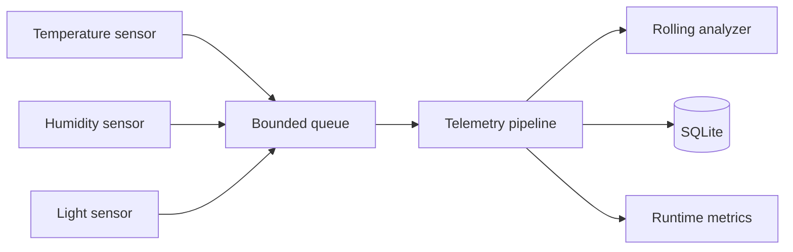

# Edge Telemetry Lab

A dependency-free Python reference project for building reliable telemetry pipelines at the edge. It simulates sensors, applies bounded-queue backpressure, retries transient write failures, calculates rolling statistics, and persists readings to SQLite.

This repository is designed as a practical programming challenge for computer engineering and software internship portfolios: the emphasis is not just on making data flow, but on making the flow **testable, observable, and resilient**.

## What it demonstrates

- `asyncio` producer/consumer design
- Backpressure with bounded queues
- Retry with exponential backoff
- Typed domain models and validation
- SQLite persistence and aggregate queries
- Rolling-window anomaly detection
- Structured metrics
- Automated tests and GitHub Actions

## Architecture



## Quick start

Requires Python 3.11+.

```bash
python -m edge_telemetry.cli --readings 12 --interval 0.01
python -m unittest discover -s tests -v
```

Example summary:

```text
processed=36 persisted=36 retries=0 dropped=0
temperature: count=12 mean=23.91 min=21.18 max=26.42
humidity: count=12 mean=54.12 min=43.06 max=67.51
light: count=12 mean=593.42 min=102.03 max=973.66
```

## Design decisions

### Bounded queues

An unbounded queue can hide overload until memory usage becomes the failure. This project makes capacity explicit and records dropped readings when producers cannot enqueue before a configurable timeout.

### Retry only transient sink failures

The pipeline retries `TransientStorageError` with exponential backoff. Validation and programming errors fail fast rather than being retried indefinitely.

### SQLite at the edge

SQLite provides a useful local buffer when a device is offline. The schema includes an index optimized for sensor/time queries.

## Repository layout

```text
edge_telemetry/       Production code
tests/                Unit and integration tests
.github/workflows/    CI configuration
CHALLENGES.md         Extension tasks with acceptance criteria
```

## Run the checks

```bash
python -m compileall edge_telemetry
python -m unittest discover -s tests -v
```

## License

MIT

